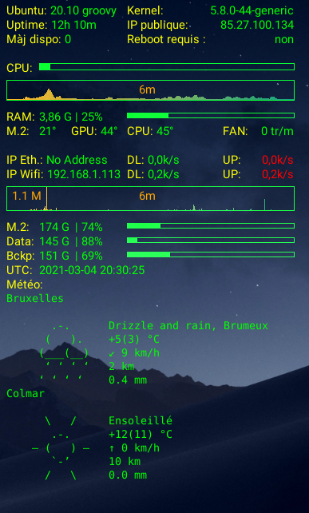

# Conkyrc

Mes configurations [Conky](https://github.com/brndnmtthws/conky) (moniteur système sur le bureau).



## Configurations

| Fichier | Machine |
|---|---|
| `configs/conkyrc-principal` | Configuration de référence |
| `configs/conkyrc-debian-tspcr32` | Debian sur le TSPCR32 |
| `configs/conkyrc-t14` | ThinkPad T14 |
| `configs/conkyrc-x250` | ThinkPad X250 |
| `configs/conkyrc-vanille` | Version de base, sans personnalisation |

## Installation

```bash
cp configs/conkyrc-t14 ~/.conkyrc   # choisir le fichier de sa machine
conky &
```
