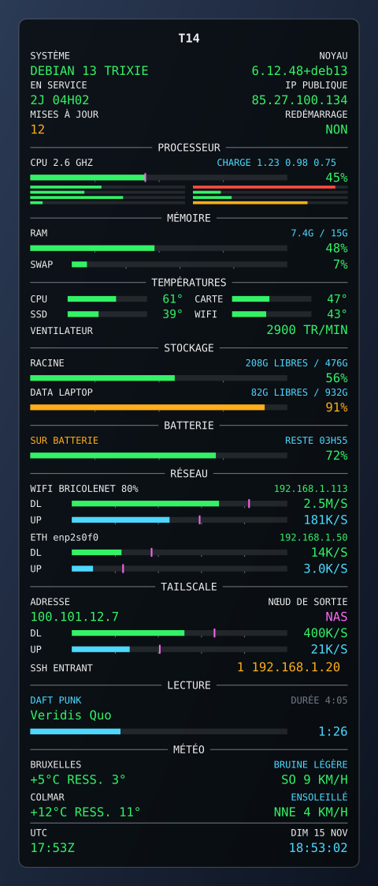

# Conkyrc

Mes configurations [Conky](https://github.com/brndnmtthws/conky) (moniteur système sur le bureau).

## Nouvelle version : Conky MCDU (Lua)

Panneau inspiré des MCDU d'avion : tout est dessiné en Lua/Cairo, avec les codes couleur des cockpits et des barres horizontales.



*Aperçu produit par le simulateur `tests/apercu.lua` (machine fictive, police de remplacement).*

| Couleur | Sens |
|---|---|
| blanc | étiquettes et titres |
| vert | valeur normale |
| cyan | information secondaire, débit montant |
| ambre | avertissement (CPU > 70 %, disque > 80 %, mises à jour, batterie < 25 %) |
| rouge | alerte (CPU > 90 %, disque > 92 %, température > 85 °C) |
| magenta | pic des 60 dernières secondes, nœud de sortie Tailscale |

Les débits réseau utilisent une échelle logarithmique : les graduations marquent 10 Ko/s, 100 Ko/s, 1 Mo/s et 10 Mo/s.

### Installation

```bash
sudo apt install conky-all          # Debian (Manjaro : sudo pacman -S conky)
git clone https://github.com/Bricoletonk/Conkyrc.git ~/Conkyrc
~/Conkyrc/scripts/install-mcdu.sh t14              # essai, à côté de l'ancien Conky
~/Conkyrc/scripts/install-mcdu.sh t14 --remplacer  # ne garder que le nouveau
```

Profils fournis : `t14`, `x250`, `thinkcentre`, `principal`, `tspcr32`, `defaut`.
L'installateur télécharge la police [B612 Mono](https://github.com/polarsys/b612) (police des cockpits Airbus) si elle manque, et signale les commandes facultatives absentes (`curl`, `playerctl`, `nmcli`).

### Personnaliser

Chaque profil (`lua/profils/<machine>.lua`) ne contient que ce qui change par rapport à `lua/profils/defaut.lua`, qui décrit toutes les options : ordre et choix des sections, villes pour la météo, disques, couleurs, police.
Pour agrandir tout le panneau d'un coup (police, barres, largeur) sur un écran haute densité : `echelle = 1.2` dans le profil (c'est le réglage du T14).
Après modification, relancer l'installateur avec le même profil.

Cartes réseau, capteurs et batteries sont détectés automatiquement à chaque démarrage. Les sections sans information se masquent d'elles-mêmes : batterie, Tailscale, connexions SSH entrantes, musique en cours.

### Fonctionnement

| Fichier | Rôle |
|---|---|
| `lua/mcdu.lua` | point d'entrée appelé par Conky à chaque seconde |
| `lua/lib/sysinfo.lua` | lecture de `/proc` et `/sys` (CPU, mémoire, capteurs, batterie, réseau, SSH) |
| `lua/lib/async.lua` | commandes lentes (météo, mises à jour, Tailscale...) lancées en arrière-plan pour ne jamais figer l'affichage |
| `lua/lib/draw.lua` | dessin : textes, barres, titres de section |
| `lua/lib/sections.lua` | contenu de chaque section |
| `lua/conky-mcdu.conf` | modèle de la fenêtre Conky (position, taille) |
| `tests/apercu.lua` | simulateur : `lua tests/apercu.lua t14 apercu.svg` produit une image sans Conky |

Sous GNOME en Wayland, Conky s'affiche via XWayland, comme les anciennes configurations.
Si le panneau est coupé en bas : `HAUTEUR=1150 scripts/install-mcdu.sh t14`.
Pour voir les erreurs : `conky -c ~/.config/conky/mcdu.conf` dans un terminal.

Désinstaller : `pkill -f mcdu.conf; rm -r ~/.config/conky/mcdu ~/.config/conky/mcdu.conf ~/.config/autostart/conky-mcdu.desktop`

## Anciennes configurations (texte)


### Configurations

| Fichier | Machine |
|---|---|
| `configs/conkyrc-principal` | Configuration de référence |
| `configs/conkyrc-debian-tspcr32` | Debian sur le TSPCR32 |
| `configs/conkyrc-t14` | ThinkPad T14 |
| `configs/conkyrc-x250` | ThinkPad X250 |
| `configs/conkyrc-thinkcentre` | ThinkCentre M sous Manjaro (sans batterie, interface réseau détectée à l'installation) |
| `configs/conkyrc-vanille` | Version de base, sans personnalisation |

### Installation des anciennes configurations

Méthode simple (recommandée) : installe le script d'aide, détecte les cartes réseau de la machine et ajoute le démarrage automatique de Conky.

```bash
git clone https://github.com/Bricoletonk/Conkyrc.git ~/Conkyrc
~/Conkyrc/scripts/install-conky.sh configs/conkyrc-thinkcentre   # ou conkyrc-t14
```

Méthode manuelle :

```bash
cp configs/conkyrc-t14 ~/.conkyrc   # choisir le fichier de sa machine
conky &
```

#### Script d'aide (requis par `conkyrc-t14`)

`scripts/conky-sensors.sh` retrouve les capteurs par leur nom plutôt que par leur numéro `hwmonX`, qui change à chaque démarrage. Il affiche les températures et le ventilateur disponibles, et l'état de Tailscale.

```bash
mkdir -p ~/.config/conky
cp scripts/conky-sensors.sh ~/.config/conky/
chmod +x ~/.config/conky/conky-sensors.sh
~/.config/conky/conky-sensors.sh diag   # liste tous les capteurs détectés
```

Quand Tailscale est connecté, une section rouge apparaît sous le réseau avec l'IP Tailscale, le nœud de sortie éventuel et le graphe du trafic qui passe par le tunnel.
