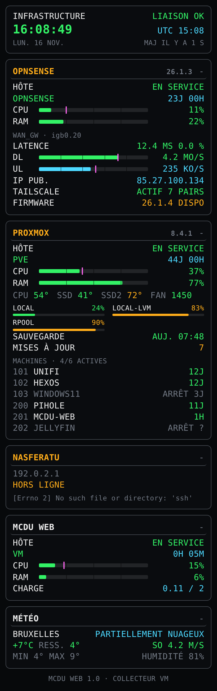

# MCDU Web : le panneau sur le téléphone

Le panneau « infra » de Conky MCDU dans un navigateur : téléphone, tablette, autre PC.
Il s'installe sur l'écran d'accueil comme une appli (webapp, PWA).



*Aperçu avec des serveurs simulés ; NASFERATU est volontairement hors ligne.*

## Principe

```
téléphone ──Tailscale (HTTPS)──▶ conteneur LXC « mcdu-web » ──SSH (clé limitée)──▶ OPNsense, Proxmox
                                   mcdu_web.py                ──SNMPv3──────────────▶ Nasferatu
                                                              ──HTTPS───────────────▶ wttr.in (météo)
```

- `mcdu_web.py` tourne en continu sur une machine toujours allumée (un petit conteneur LXC sur Proxmox).
  Il interroge les serveurs avec **les mêmes scripts de mesures** que le panneau Conky
  (`serveurs/mcdu-pve.sh`, `serveurs/mcdu-opnsense.sh`, `lua/scripts/mcdu-synology.sh`) :
  rien de nouveau à installer sur les serveurs.
- La page (`static/`) relit les mesures toutes les 5 s, et se met en pause quand l'écran est éteint.
- Python 3.11 ou plus récent, **sans aucune dépendance**.

Mêmes couleurs que le panneau Conky : vert normal, ambre avertissement, rouge alerte, magenta pic de la dernière minute.
Un appui sur un titre replie la section : il reste une ligne de résumé, et le titre passe en ambre ou en rouge s'il cache une alerte.
Si le téléphone perd la liaison, l'en-tête affiche « LIAISON PERDUE » et les dernières mesures restent visibles, grisées.

## Installation

### 1. Conteneur LXC sur Proxmox

Dans l'interface Proxmox : *Create CT*, modèle Debian 13, 1 cœur, 512 Mo de RAM, 4 Go de disque,
une IP sur un VLAN qui voit OPNsense (192.168.2.1), Proxmox (192.168.3.2) et Nasferatu (192.168.30.3).

Pour Tailscale dans le conteneur, ajouter sur l'hôte Proxmox, dans `/etc/pve/lxc/<ID>.conf` :

```
lxc.cgroup2.devices.allow: c 10:200 rwm
lxc.mount.entry: /dev/net/tun dev/net/tun none bind,create=file
```

puis redémarrer le conteneur.

### 2. MCDU Web

Dans le conteneur, en root :

```bash
apt install -y git
git clone https://github.com/Bricoletonk/Conkyrc.git /root/Conkyrc
/root/Conkyrc/web/installer-web.sh
```

L'installateur copie le programme dans `/opt/mcdu-web`, crée `/etc/mcdu-web/config.toml`,
une **clé SSH dédiée** et le service `mcdu-web` (port 8080). À la fin, il affiche les lignes à coller
pour autoriser cette clé sur Proxmox et OPNsense : comme celle du panneau Conky, elle ne peut lancer
que le script de mesures (`command="…",restrict`).

Vérifier ensuite les adresses dans `/etc/mcdu-web/config.toml`, puis `systemctl restart mcdu-web`.

Mise à jour : `cd /root/Conkyrc && git pull && web/installer-web.sh` (la configuration et la clé sont conservées).

### 3. HTTPS avec Tailscale

Un téléphone n'installe une webapp que si elle est servie en HTTPS. Tailscale s'en charge, avec un vrai certificat :

```bash
curl -fsSL https://tailscale.com/install.sh | sh
tailscale up --hostname mcdu
tailscale serve --bg 8080
```

La page est alors sur `https://mcdu.<ton-tailnet>.ts.net/`, joignable de partout dès que Tailscale est actif
sur le téléphone, et de nulle part ailleurs. (Activer *HTTPS Certificates* dans la console Tailscale si ce n'est pas fait.)

Pour n'accepter que Tailscale : `adresse = "127.0.0.1"` dans `config.toml`.

### 4. Sur le téléphone

Ouvrir l'adresse ci-dessus, puis :
- **Android (Chrome)** : menu ⋮ → *Ajouter à l'écran d'accueil* (ou *Installer l'application*)
- **iPhone (Safari)** : bouton Partager → *Sur l'écran d'accueil*

## Configuration

`/etc/mcdu-web/config.toml` (modèle commenté : [`config.exemple.toml`](config.exemple.toml)) :
une section `[[source]]` par serveur, dans l'ordre d'affichage.

| `type` | Lecture |
|---|---|
| `ssh` | script de mesures du serveur, avec la clé dédiée |
| `snmp` | NAS Synology, rien à installer dessus (fichier d'options SNMPv3) |
| `local` | la machine qui fait tourner MCDU Web |

## Dépannage

```bash
journalctl -u mcdu-web -f                      # erreurs de connexion aux serveurs
curl -s localhost:8080/api/etat | head -c 600  # mesures brutes
sudo -u mcdu-web ssh -i /etc/mcdu-web/mcdu_ed25519 -o IdentitiesOnly=yes root@192.168.3.2 mcdu
```

Sous chaque serveur hors ligne, la page affiche la dernière erreur (clé refusée, délai dépassé...).

## Fichiers

| Fichier | Rôle |
|---|---|
| `mcdu_web.py` | collecteur et serveur web |
| `static/` | la page : `mcdu.js` (affichage), `mcdu.css`, `sw.js` (ouverture hors ligne), manifeste et icônes |
| `installer-web.sh` | installation ou mise à jour dans le conteneur |
| `mcdu-web.service` | service systemd (lecture seule, utilisateur dédié) |
